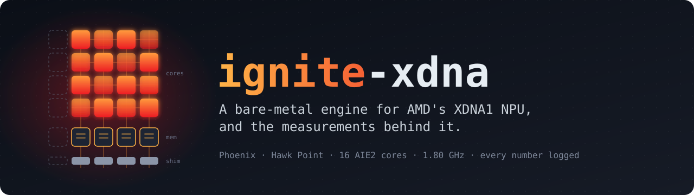

<p align="center">
  
</p>

<p align="center">
  <b>YOLO, pose and super-resolution networks run entirely on the AMD Ryzen™ AI NPU, through an engine written from the silicon up.</b><br>
  Plus the study that started it: thirteen models through AMD's own stack, every success and every failure measured.
</p>

<p align="center">
  
  
  
  
  
  <br>
  <a href="results/README.md"></a>
  <a href="https://huggingface.co/jdominick05/ignite-xdna"></a>
  <a href="https://github.com/jdominick05/Ignition"></a>
  <a href="https://github.com/jdominick05/ignite-xdna/commits"></a>
  <a href="LICENSE"></a>
</p>

---

**This is research, not a packaged tool.** The deliverable is measurements: every number on this page links to its
working in [`docs/BENCHMARKS.md`](docs/BENCHMARKS.md), backed by a log under [`results/`](results/README.md). Which of
its XDNA1 facts are new and which were already public is [audited against prior art](results/aie/notes_tnzr_cross_audit.md#d-novelty).
For a one-line install that runs YOLO on your NPU, use [**Ignition**](https://github.com/jdominick05/Ignition), the SDK built on this engine.

## At a glance

| | Result |
|---|---|
| 🔥 **Whole network, bit-exact** | YOLOv8n, YOLOv8s, YOLOv8n-pose and SESR M7 run every layer on the NPU with **0** CPU partitions ([measured](docs/BENCHMARKS.md#whole-network-yolov8n-on-a-16-core-convolution-engine-every-layer-on-the-npu-bit-exact-2026-09-13-desktop-2)) |
| 🎯 **More accurate than AMD's stack** | mAP@50-95 on all 5000 COCO images: **34.12 / 42.37 / 44.16** (v8n / v8s / pose) against AMD's **26.68 / 37.31 / 32.64**, no AdaRound ([accuracy](docs/BENCHMARKS.md#the-sigmoid-silu-containers-against-amds-stack-more-accurate-on-all-5000-coco-images-faster-on-yolov8n-and-yolov8n-pose-slower-on-yolov8s-2026-09-17-desktop-2)) |
| 🚀 **And faster end to end** | YOLOv8n **7.15 vs 10.84 ms** (AMD tuned 10.17–10.26), pose **7.50 vs ≥ 9.15**, YOLOv8s 15.77 vs 17.22–17.25 against AMD's default, in one pre-registered sitting ([sitting](docs/BENCHMARKS.md#the-release-re-sit-against-amds-stack-ignition-faster-on-yolov8n-pose-yolo11n-and-yolo26n-amd-faster-on-sesr-m7-yolov8m-l-and-x-and-on-yolov8s-once-tuned-2026-10-19-desktop-2)) |
| ⚡ **3.4–3.7× faster where attention breaks AMD's stack** | YOLO11n **9.85–9.88 vs 36.2–37.0 ms**, YOLO26n **10.77–10.83 vs 37.18–37.19** ([sitting](docs/BENCHMARKS.md#the-release-re-sit-against-amds-stack-ignition-faster-on-yolov8n-pose-yolo11n-and-yolo26n-amd-faster-on-sesr-m7-yolov8m-l-and-x-and-on-yolov8s-once-tuned-2026-10-19-desktop-2)); YOLO-World v2 **2.75×** glass to glass ([sitting](docs/BENCHMARKS.md#yolo-world-v2-glass-to-glass-275-times-amds-stack-and-against-the-igpu-it-depends-on-the-vocabulary-2026-09-16-desktop-2)) at **4.3–5.0×** less energy per frame ([energy](docs/BENCHMARKS.md#yolo-world-v2-energy-per-frame-43-50-times-less-than-amds-stack-and-the-igpu-spends-less-at-5-fps-2026-09-17-desktop-2)) |
| ⚖️ **Not faster everywhere** | AMD wins SESR M7 (3.97–4.26 vs 4.46–4.54 ms), YOLOv8s once its compiler is tuned (**14.60–14.66 vs 15.77**), and YOLOv8m / l / x by **1.23× / 1.36× / 1.43×**: the bigger the model, the bigger AMD's lead ([sitting](docs/BENCHMARKS.md#the-release-re-sit-against-amds-stack-ignition-faster-on-yolov8n-pose-yolo11n-and-yolo26n-amd-faster-on-sesr-m7-yolov8m-l-and-x-and-on-yolov8s-once-tuned-2026-10-19-desktop-2)) |
| 🧠 **Transformers AMD's stack does not place** | Laya (ModernBERT-large, bf16) at **607.9 ms**, faster than the 780M (754.9) and the CPU (869.5); EmbeddingGemma's encoder with attention on the NPU, though the 780M is 2.7× faster there ([beyond AMD's stack](#beyond-amds-stack)) |
| 🧮 **Past the shipped runtime** | Hand-written kernels reach **int4 6,195 GOPS** and **bf16 2,072.5 GFLOPS** (1.18–1.78× the CPU), neither reachable through Quark or the VitisAI EP ([kernels](#hand-written-aie-kernels)) |
| 📉 **Honest ceilings** | AMD's stack tops out at **39.3%** of the 16 TOPS nameplate, and two earlier answers to that question are retracted ([working](docs/BENCHMARKS.md#achieved-opss-a-real-answer-to--of-16-tops-not-a-gops-estimate)) |

```python
from ignite_xdna import InferenceSession
with InferenceSession.from_file("build/yolov8n_full.ignite") as s:   # ignite-compile --engine graph
    heads = s.run_yolo_monolithic(input_data)   # whole network on the NPU, every layer bit-exact
    preds = s.decode_yolo_predictions(heads)
```

## Does this run on your machine?

Most of this narrowness is not optional.

| | Required | Otherwise |
|---|---|---|
| **Chip** | Hawk Point or Phoenix (XDNA1, `AMD_AIE2_4x4_Overlay`, `target: "X1"`) | Strix (XDNA2) is a different architecture and untouched here |
| **OS** | Windows | Linux is untested |
| **SDK** | Ryzen AI **1.7.1** for inference, 1.8.0 for export / quantize | 1.8.0 ships no Phoenix xclbin and cannot run inference on this chip |
| **Shell** | PowerShell, plus Git Bash for `scripts/` | cmd prints `%VAR%` back instead of erroring |
| **Workload** | CNN INT8 on AMD's stack; the engine and `kernels/` go further | AMD's current release lists no XDNA1 LLM path; RyzenAI-SW 1.1–1.3.1 once shipped one ([prior art](results/llm/notes_prior_art_phoenix_llm.md)) |

Environments, install and footguns: [`docs/SETUP.md`](docs/SETUP.md).

## Quickstart

The engine runs in the `mlir-aie-iron` env; the VitisAI study uses `resnet_env` (1.8.0, export and quantize) and
`resnet_env17` (1.7.1, inference). Study scripts run from **Git Bash**:

```bash
./scripts/setup.sh          # one-time: export, fetch datasets, quantize
./scripts/resnet-bench.sh   # the ResNet50 table
./scripts/yolo-cut.sh       # YOLO on the NPU: cut, quantize, run, verify
./scripts/yolo-eval.sh      # COCO bbox mAP         ./scripts/pose-eval.sh   # OKS mAP
./scripts/diag.sh           # what the VitisAI EP actually took
```

Every model has a recipe in [`recipes/`](recipes/README.md): the pinned download, export, quantize and compile
steps behind each container, which `python tools/recipe.py build <model>` replays and `status` checks against the
files on disk. Each container's manifest records the recipe step and compiler commit that built it.

`ignite-compile --engine graph` builds the container above. The older `build/yolov8n.ignite` runs one conv layer
per stage and carries no heads ([measured](docs/BENCHMARKS.md#whole-network-yolov8n-on-a-16-core-convolution-engine-every-layer-on-the-npu-bit-exact-2026-09-13-desktop-2)).
Per-model engine results: [`docs/MODEL_ZOO_BENCHMARKS.md`](docs/MODEL_ZOO_BENCHMARKS.md). Native graph stages can
also share buffers with custom AIE kernels through `ignite_xdna.runtime.KernelSplicer` ([scope and measurements](docs/BENCHMARKS.md#native-bo-kernel-splicing-2026-09-13-desktop-2)).

## The engine

`src/ignite_xdna/` lowers supported ONNX graphs to `.ignite` containers and runs them through PyXRT ring
buffers. Where a model has ops it cannot place, the manifest says so: YOLO11n keeps only its attention core (two
MatMuls and a softmax) on the CPU, YOLO-World v2 its four text-attention blocks.

- **YOLO11n**: with that one host segment it reads **34.63** mAP@50-95 against AMD's 25.82
  ([carve](docs/BENCHMARKS.md#yolo11ns-carve-the-narrow-one-is-free-on-accuracy-074-ms-faster-and-unlocks-883-map-2026-09-21-desktop-2)),
  superseding a first carve measured on 2026-09-15 ([how](docs/BENCHMARKS.md#yolo11ns-c2psa-convolutions-on-the-npu-only-its-attention-core-on-the-host-2026-09-15-desktop-2)).
- **YOLO-World v2**: class names change on an open container in about 90 ms
  ([how](docs/BENCHMARKS.md#yolo-world-v2s-vocabulary-chosen-at-run-time-one-container-any-class-names-2026-09-16-desktop-2)),
  at 24.7% mAP on the first 300 val images ([how](docs/BENCHMARKS.md#yolo-world-v2-with-only-its-text-attention-on-the-cpu-gptq-and-an-int32-bias-recover-the-four-output-convolutions-2026-09-16-desktop-2)).
- **Dense segmentation and matting** are exact where AMD's stack is not, but about half of each runs on the host,
  so they are not speed results.

## Beyond AMD's stack

The current Ryzen AI releases run XDNA1 as CNN INT8 only: their EP places **0 of 430** nodes of a bf16 graph on the
NPU. The engine runs bf16 transformers there, so these compare against the CPU and the 780M iGPU on the same chip
([all of it, with caveats](docs/BENCHMARKS.md#beyond-amds-stack-what-runs-on-this-npu-that-ryzen-ai-does-not-offer-summary-2026-10-19-desktop-2)):

- **Laya**, a ModernBERT-large decision model: **607.9 ms** at 512 tokens, the fastest of three backends (780M
  754.9, CPU 869.5), as a hybrid with attention on the host. Run entirely on the NPU, with zero CPU neural ops, it
  passes its frozen accuracy gates on 2,400 items, but takes 1,889 ms.
- **EmbeddingGemma 2**: weight GEMMs, local and global attention and GeGLU on the NPU, **1,158.9 ms** per
  2,048-token document at cosine ≥ 0.99998 to fp32. **The 780M is 2.7× faster**; running both together adds
  13–14% documents per second.
- **Energy**: the NPU reads a GB for **0.33 J**, against DirectML's 0.75 and the CPU's 0.88.
- **Not here:** decoding a 7B LLM. The NPU reads DDR at 47.6 GB/s, below the 56–64 GB/s at which the CPU and the
  780M read int4 weights.

## The VitisAI study

| Pipeline | Model | Status on AMD's stack |
|---|---|---|
| `resnet50` | timm `resnet50.a1_in1k` | ✅ **79.80%** top-1 at **5.27 ms** (XINT8 + AdaRound) |
| `yolov8n` | YOLOv8 n / s / m / l / x | ✅ **8.94–117.11 ms** once the decode tail is cut off the graph |
| `yolov8n-pose` | YOLOv8n-pose, 17 keypoints | ✅ **9.35 ms**, OKS mAP 34.32 with AdaRound (49.86 float) |
| `yolov6n` | YOLOv6n (RepVGG, no DFL) | ✅ **6.62 ms**, mAP 33.57 with AdaRound (36.95 float) |
| `fastdepth` / `midas` | monocular depth | ✅ FastDepth **2.87 ms**, beats the iGPU's 3.02; MiDaS 10.81 ms |
| `sesr` / `realesrgan` | super-resolution | ✅ SESR-M7 **1.48 ms** (iGPU 4.48); Real-ESRGAN 14.02 ms (iGPU 18.34) |
| `bisenetv2` | bilateral segmentation | ⚠️ 13.12 ms, but its softmax error is 4.13× the CPU's ([why](docs/BENCHMARKS.md#the-mul-is-not-the-fault-a-long-lived-activation-is-2026-09-09-desktop-2)) |
| `yolov11` | YOLOv11n (C2PSA attention) | ⚠️ fractured, 6 of 1300 nodes at 33.29 ms; the engine runs it (above) |
| `yolow` | YOLO-World v2 | ⚠️ fractured, 48 of 1081 nodes at 103.31 ms; the engine runs it (above) |
| `mobilevit` | MobileViT-XXS | ❌ **0.00%** top-1 after INT8, kept as the negative result |
| `quant/` | Ignition Alpha, the owned XINT8 producer (not the SDK) | 🧪 reproduces Quark's XINT8 and AdaRound byte for byte on ResNet, YOLOv8n-cut and MODNet ([quickstart](quant/README.md), [validation](docs/BENCHMARKS.md#ignition-alpha-release-validation), [AdaRound parity](docs/BENCHMARKS.md#ignition-adaround-parity)) |

<details>
<summary><b>YOLOv8 width sweep</b>: head-cut plain XINT8, all 5000 val2017 images</summary>

| Model | NPU latency | mAP@50-95 | mAP@50 | NPU nodes | Calibration images |
|---|---|---|---|---|---|
| yolov8n | **8.94 ms** | 26.94 | 40.15 | 922 / 929 | 200 |
| yolov8s | **15.63 ms** | 37.40 | 53.13 | 922 / 929 | 200 |
| yolov8m | **26.95 ms** | 43.38 | 59.62 | 1216 / 1223 | 200 |
| yolov8l | **49.67 ms** | 45.37 | 62.34 | 1510 / 1517 | 32 |
| yolov8x | **117.11 ms** | 45.09 | 61.37 | 1510 / 1517 | 24 |

Conf 0.001, IoU 0.7, max_det 300, per-class NMS. **Not like-for-like:** l and x are calibrated on fewer images
(~1–1.5 GB of activations per image at 640²); width dominates accuracy, and yolov8l's full eval is flaky. Calibration
images are among the 5000 scored; rescored on the other 4,700, nothing moved more than 0.07 points beyond the float
model's own shift ([pitfall](docs/DECISIONS.md#rejected-approaches-and-known-pitfalls)). Working:
[model size](docs/BENCHMARKS.md#model-size-n-vs-s-measured-together).
</details>

## What the study found

- **A float decode tail makes the EP refuse the whole graph.** Quantized YOLOv8n ran at CPU speed with **0 of 965**
  nodes on the NPU; cutting 18 DFL/anchor nodes gives **922 of 929** and 8.7–9.8 ms
  ([working](docs/BENCHMARKS.md#the-yolov8n-blocker-and-how-it-was-solved)).
- **Silent CPU fallback is the failure to watch for.** Only `vitisai_ep_report.json` proves placement, and placement
  is not correctness: [Ignition's probes](docs/BENCHMARKS.md#ignition-controlled-resnet-qdq-acceptance) catch wrong
  NPU logits. A8W8, A16W8 and batch 2 all fall back without an error.
- **AdaRound recovers classification, not detection.** ResNet50: 71.70% → **79.80%** (float 80.10%). yolov8s gains
  only +2.58 mAP, and a 500-image slice had suggested far more
  ([working](docs/BENCHMARKS.md#model-size-n-vs-s-measured-together)).
- **Three ways to lose to a Zen 4 CPU.** Too cheap to accelerate (MobileNetV2), normalization the EP cannot fold
  (`resnetv2_50x3_bit`, 25% slower), and ops with no kernel (MobileViT)
  ([working](docs/BENCHMARKS.md#pushing-width-further-resnetv2_50x3_bit-and-a-second-way-to-lose-to-cpu)).
- **The iGPU on the same chip is a serious competitor.** yolov8n FP16 on DirectML: 9.9–10.5 ms at zero mAP loss,
  against the NPU's 6.8–6.9 ms at 4.5 points lost
  ([working](docs/BENCHMARKS.md#igpu-vs-npu-is-ryzen-ai-worth-it-over-directml)).
- **Batching is unsafe; concurrency is not.** Static batch 2 writes only slot 0, with a plausible latency; two
  independent sessions give **1.8–1.9×** throughput with zero cross-talk
  ([batching](docs/BENCHMARKS.md#batching-does-it-help-throughput) ·
  [concurrency](docs/BENCHMARKS.md#two-cameras-does-independent-concurrency-work-where-batching-doesnt)).
- **FLOPs do not predict latency here.** yolov8s is 3.2× yolov8n's arithmetic for 1.75× the time, and l → x buys
  no accuracy for 2.36× the latency.

## Hand-written AIE kernels

The XINT8-only ceiling is the *shipped runtime's*, not the silicon's. `mlir-aie` / Peano reaches the cores directly
on Windows, and the outcomes in [`kernels/`](kernels/README.md) are mostly negative, all measured:

| Kernel | Outcome |
|---|---|
| **int8×int4 GEMM** | ✅ **6,195 GOPS**, 1.26× int8 at its best tile; the `vmac` AMD's `device.yaml` omits, bit-exact |
| **bf16 GEMM** | ✅ **2,072.5 GFLOPS** at 1024³, 1.18–1.78× CPU bf16 once M, N ≥ 1024; 1.33× at a 7B projection shape |
| **int8 GEMM** | ✅ **4,448–4,607 GOPS** with an `n=64` tile, 1.10–1.83× at M ≥ 512, N ≥ 2048; prefill loses |
| **int8 conv** | ❌ CPU wins 2.4× even after a 3× fix; the op class is closed |
| **bf16 attention (MobileViT)** | ❌ 71–240× slower: the kernel never called `aie::mmul` |
| **bf16 GroupNorm** | ❌ beat the CPU on 33 of 49 nodes, then the two-process handoff erased all 33 |

**Go / no-go:** CPU time must exceed the host-set dispatch floor: **617 µs** one-shot IRON, **~531 µs** batched,
**36.7 µs** batched C++. The core clock is **1.80 GHz**, measured ([`docs/SILICON.md`](docs/SILICON.md)).

## Where the detail lives

| Document | What it is for |
|---|---|
| [`RESEARCH.md`](RESEARCH.md) | The question being asked, and what is still open |
| [`docs/BENCHMARKS.md`](docs/BENCHMARKS.md) | Every measurement, with its working, caveats and superseded history |
| [`docs/DECISIONS.md`](docs/DECISIONS.md) | Locked decisions, rejected approaches, and the traps behind each |
| [`docs/SILICON.md`](docs/SILICON.md) | The physical array: geometry, clocks, ceilings, each figure tagged by how it is known |
| [`docs/SETUP.md`](docs/SETUP.md) | Compatibility, the environments, install, manual steps |
| [`docs/MODEL_ZOO_BENCHMARKS.md`](docs/MODEL_ZOO_BENCHMARKS.md) | Per-model engine results |
| [`results/`](results/README.md) | The logs: the evidence for every number above |

<details>
<summary><b>Repo layout</b></summary>

```
src/ignite_xdna/      the engine: compiler/, runtime/, pipelines/, quantization/ (+ tests/)
npu/                  shared library for the VitisAI study
pipelines/<name>/     1_export -> 2_fetch_data -> 3_quantize -> 4_run/detect/pose -> 5_eval_map
benchmarks/           silicon benchmark suites, and Vitis AI vs ignite-xdna
kernels/ tools/       hand-written AIE2 kernels; disassemblers, probes, auditors
scripts/ results/     bash wrappers; tracked logs, the evidence for every number
models/  data/        generated, git-ignored, expensive to regenerate (pass --fresh when they change)
```
</details>

## Known limitations

One chip generation and one SDK version; Windows only; batch 1 only. The full-graph YOLOv8 is deliberately left in
the state the EP refuses, as the control for the head-cut result. AdaRound at 640×640 needs more RAM than the 13.8 GB
laptop has; yolov8l's full eval is flaky; NPU utilization can't be read through standard Windows tooling. The study
half has no unit tests and cannot have them, its subject being the hardware; the engine's `tests/` cover offline
invariants only. The full list: [`docs/BENCHMARKS.md`](docs/BENCHMARKS.md#known-limitations).

## Contributing

Contributions are welcome; see [CONTRIBUTING.md](CONTRIBUTING.md). Measurements on Strix or on a bigger machine are
especially useful. Changes must pass the syntax/import gate in `CONTRIBUTING.md` and include logged measurements
under `results/`.

## Acknowledgements and license

Adapted from AMD's Ryzen AI `CNN-examples/object_detection` samples. Models are timm's `resnet50.a1_in1k`,
`wide_resnet50_2.racm_in1k`, `wide_resnet101_2.tv2_in1k`, and Ultralytics YOLOv8.

The whole repository, the engine under `src/ignite_xdna/` included, is licensed under the
[GNU Affero General Public License v3.0 or later](LICENSE): use, study, modify and share it freely, including
commercially, but any version you distribute or run as a network service must also be open-sourced under the AGPL.
That follows from `pipelines/yolov8n/1_export.py` importing `ultralytics`, whose YOLOv8 code is AGPL-3.0. Models and
containers are on [Hugging Face](https://huggingface.co/jdominick05/ignite-xdna) under their upstream licences
(`python tools/fetch_hf_artifacts.py`); `data/` is never redistributed. The few files copied from mlir-aie keep
AMD's notice and licence, and say so in their header.
